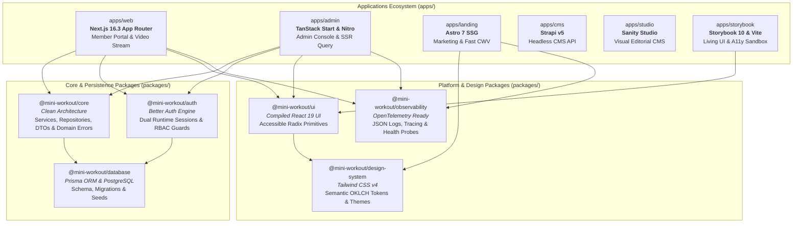

# Mini Workout — Production-Grade Full-Stack & Next.js Architecture Showcase

> A modern full-stack Turborepo monorepo designed as an **advanced learning platform and real-world production reference**.
> Showcases cutting-edge **Next.js 16.3 (App Router)**, **React 19**, **Node.js 22**, **Prisma ORM & PostgreSQL**, **Better Auth**, **TanStack Start**, **Astro 7**, **Strapi v5**, **Storybook 10**, **Tailwind CSS v4**, and an **Enterprise AI Agent Development Harness**.

---

## System Overview & Architecture

Mini Workout demonstrates how to build and operate a distributed, multi-application digital platform with clean domain boundaries, unified design semantics, and automated quality gates.



### Application Workspaces

| Workspace                          | Technology Stack                                           | Purpose & Production Role                                                                                                                                      |
| :--------------------------------- | :--------------------------------------------------------- | :------------------------------------------------------------------------------------------------------------------------------------------------------------- |
| [`apps/web`](apps/web)             | **Next.js 16.3**, React 19, Video.js 10, Tailwind CSS v4   | **Member Portal:** Workout discovery, interactive multi-step onboarding, adaptive HLS/MP4 streaming video player, likes, favorites, and profile customization. |
| [`apps/admin`](apps/admin)         | **TanStack Start**, Nitro, TanStack Router, TanStack Query | **Operations Console:** Back-office administration, type-safe search parameters, SSR data hydration, cursor-based user and content pagination.                 |
| [`apps/landing`](apps/landing)     | **Astro 7**, Sanity Client, Tailwind CSS                   | **Public Marketing:** High-performance static site generation (SSG), optimal Core Web Vitals, editorial visual editing preview.                                |
| [`apps/cms`](apps/cms)             | **Strapi v5** (Self-hosted Headless CMS)                   | **Content Management:** Relational models for coaches, categories, workout catalog metadata, and API permission tokens.                                        |
| [`apps/studio`](apps/studio)       | **Sanity Studio**                                          | **Editorial Workspace:** Visual campaign management, dynamic pricing tier schemas, and landing content authoring.                                              |
| [`apps/storybook`](apps/storybook) | **Storybook 10**, Vite, `@storybook/addon-a11y`            | **Design System Explorer:** Isolated component development, interaction testing, and automated WCAG 2.1 AA accessibility auditing.                             |

### Shared Workspace Packages

- **`@mini-workout/core`**: Framework-agnostic application core containing repositories, services, domain models, DTOs, and domain error hierarchies (`NotFoundError`, `ValidationError`, `ConflictError`).
- **`@mini-workout/database`**: Persistence layer encapsulating Prisma Client, PostgreSQL schema, migrations, and seed scripts.
- **`@mini-workout/auth`**: Authentication and authorization services powered by Better Auth with dual isolated instances for Web and Admin runtimes.
- **`@mini-workout/ui`**: Standalone React component library compiled with `tsup`, utilizing Radix UI primitives with built-in accessibility.
- **`@mini-workout/design-system`**: Tailwind CSS v4 semantic design system with modern OKLCH color variables and light/dark theme adapters.
- **`@mini-workout/observability`**: Provider-agnostic telemetry contracts: structured JSON logging, PII sanitization, OpenTelemetry tracing, and `/api/health` probes.
- **`@mini-workout/analytics`**: Abstract event tracking pipeline supporting multi-provider analytics.
- **`@mini-workout/feature-flags`**: Type-safe feature flagging contracts.
- **`config/*`**: Centralized ESLint flat configs, Prettier presets, TypeScript configurations, and Vitest test setups.

---

## Technical Highlights & Learning Curriculum

This repository serves as a master-class curriculum in modern full-stack TypeScript engineering.

### 1. Frontend Engineering (Next.js 16.3 & React 19)

- **React 19 Next-Gen Primitives**:
  - Native `<ViewTransition>` for smooth layout morphing between list cards and detail hero views (`apps/web/src/components/view-transitions/`).
  - Animated Suspense boundaries combining `<ViewTransition enter="slide-up" exit="slide-down">` with streaming fallback skeletons.
  - React Compiler integration (`reactCompiler: true`) eliminating manual memoization boilerplate.
- **Next.js 16.3 Cache Components & Invalidation**:
  - Component-level caching with `cacheComponents: true` and the `'use cache'` directive.
  - Fine-grained cache lifetime (`cacheLife('hours')`) and tagging (`cacheTag`).
  - Safe cache invalidation using `updateTag()` inside Server Actions for read-your-own-writes consistency.
  - Clear architectural boundaries keeping personalized viewer state isolated from shared public catalog caches.
- **Optimistic UI with Rollback**:
  - Instant user feedback for likes and favorites via `@tanstack/react-query` mutations (`useMutation`).
  - Client-side cache snapshots on mutation start (`onMutate`) with automatic rollback on server errors (`onError`).
- **Server Actions & Form Handling**:
  - Robust multi-step onboarding wizard (`apps/web/src/features/onboarding/actions.ts`) driven by a validated server state machine.
  - Input parsing and validation with Zod (`safeParse`).
  - Unified server action error boundaries (`withServerActionErrorBoundary`) with correlation IDs.
- **Routing & Media Performance**:
  - `typedRoutes: true` for compile-time route verification.
  - `partialPrefetching: true` for lightning-fast navigations.
  - Video.js 10 custom integration supporting adaptive HLS and MP4 playback.

### 2. Backend, Database & Clean Architecture

- **Clean Architecture & Hexagonal Mindset**:
  - `packages/core` is strictly decoupled from frameworks: zero dependencies on Next.js, TanStack Start, React, HTTP headers, or cookies.
  - Repository and service patterns allow seamless database swapping without touching business logic.
  - Explicit domain error hierarchy mapping cleanly to HTTP statuses at application boundary adapters.
- **PostgreSQL & Prisma ORM**:
  - Relational schema modeling users, accounts, sessions, workouts, categories, coaches, likes, and favorites.
  - Compound indexes and unique constraints (e.g. `@@unique([userId, workoutId])`) preventing duplicate interactions.
  - Deterministic database migrations and automated seeding pipelines.
- **Modern Authentication & Authorization (Better Auth)**:
  - Database-backed session management with secure HTTP-only cookies.
  - Role-Based Access Control (RBAC) supporting `MEMBER` and `ADMIN` privileges.
  - Dual runtime instances tailoring cookie handlers specifically for Next.js App Router and TanStack Start Nitro.
  - Optimistic edge routing guard (`apps/web/src/proxy.ts`) preventing unauthorized layout flashes.
- **Standardized Error Handling & Observability**:
  - Strict compliance with [`docs/ERROR_HANDLING_CONVENTION.md`](docs/ERROR_HANDLING_CONVENTION.md).
  - Production readiness probes: `/api/health/live` (in-memory) and `/api/health/ready` (active database verification).
  - PII and credential redaction across all telemetry sinks.

### 3. Monorepo Architecture & DevOps Quality Gates

- **Turborepo 2.x Orchestration**:
  - Parallel task execution (`build`, `lint`, `check-types`, `test`) across apps and packages.
  - Strict package boundaries enforced by `eslint-plugin-boundaries` and `turbo boundaries` (packages cannot depend on apps; features cannot import sibling features).
  - Dependency version control via pnpm Catalogs in `pnpm-workspace.yaml`.
  - Smart affected change detection (`turbo run build --affected`) and Vercel remote cache integration.
- **Multi-Tier Testing Pyramid**:
  - **Unit & Integration:** Fast testing with Vitest across core domain services and utility packages.
  - **Component & Accessibility:** Storybook 10 interaction tests with automated `@storybook/addon-a11y` enforcement.
  - **Browser E2E:** Comprehensive Playwright test suite covering public journeys, authenticated workflows, mobile viewports, and visual regression.
- **Automated CI/CD Pipeline**:
  - GitHub Actions workflow ([`.github/workflows/ci.yml`](.github/workflows/ci.yml)) validating lockfile integrity, lint rules, types, build artifacts, and Playwright tests.
  - Commitlint enforcing Conventional Commits via Husky pre-commit hooks.

### 4. Enterprise AI Development Harness

- **Structured Engineering Lifecycle**:
  - Every non-trivial engineering task follows the standard 7-phase loop defined in [`.agents/phases/`](.agents/phases/):
    `00-discovery` → `01-plan` → `02-design` → `03-implementation` → `04-verification` → `05-review` → `06-handoff`.
- **Domain-Specific AI Skills**:
  - Over 20 specialized engineering skills in `.agents/skills/` (including `nextjs-app-architecture`, `nextjs-cache-architecture`, `better-auth`, `prisma-client-api`, `tanstack-start`, `storybook`, and `observability-convention`).
- **Continuous Harness Evolution**:
  - Codified rules in `AGENTS.md` and detailed operational guidance in [`docs/AGENT_WORKFLOW.md`](docs/AGENT_WORKFLOW.md).

---

## Getting Started

### Prerequisites

- **Node.js**: `>=22.12.0` (Use `nvm use` to select the version declared in `.nvmrc`).
- **pnpm**: `10.30.0` or compatible pnpm 10 release.
- **PostgreSQL**: Local PostgreSQL instance or a [Neon](https://neon.tech) serverless database.

### Installation & Development

```bash
# 1. Clone the repository and install dependencies
git clone https://github.com/quang-pham-dev/mini-workout.git
cd mini-workout
pnpm install

# 2. Configure environment variables
# Copy .env.example files to .env in apps/web, apps/admin, and packages/database
cp apps/web/.env.example apps/web/.env
cp apps/admin/.env.example apps/admin/.env
cp packages/database/.env.example packages/database/.env

# 3. Initialize database schema & seed sample data
pnpm --filter @mini-workout/database db:push
pnpm --filter @mini-workout/database db:seed

# 4. Start all applications concurrently
pnpm dev
```

### Application URLs

| Service           | Local URL                                      | Description                             |
| :---------------- | :--------------------------------------------- | :-------------------------------------- |
| **Web Portal**    | [http://localhost:3000](http://localhost:3000) | Member portal (Next.js 16.3 App Router) |
| **Admin Console** | [http://localhost:3001](http://localhost:3001) | Back-office dashboard (TanStack Start)  |
| **Storybook**     | [http://localhost:6006](http://localhost:6006) | Component explorer & a11y sandbox       |
| **Landing Site**  | [http://localhost:4321](http://localhost:4321) | Marketing landing page (Astro 7)        |
| **Strapi CMS**    | [http://localhost:1337](http://localhost:1337) | Self-hosted Headless CMS admin          |
| **Sanity Studio** | [http://localhost:3333](http://localhost:3333) | Editorial studio for marketing content  |

---

## Common CLI Commands

| Command                      | Purpose                                                              |
| :--------------------------- | :------------------------------------------------------------------- |
| `pnpm dev`                   | Start all workspace dev servers in watch mode through Turborepo.     |
| `pnpm build`                 | Build all packages and applications with Turborepo remote caching.   |
| `pnpm build:apps`            | Build deployable applications under `apps/*`.                        |
| `pnpm build:packages`        | Build shared internal packages under `packages/*`.                   |
| `pnpm lint`                  | Execute ESLint flat config checks across all workspaces.             |
| `pnpm lint:fix`              | Automatically apply safe linting fixes.                              |
| `pnpm format`                | Validate code formatting with Prettier.                              |
| `pnpm format:fix`            | Apply Prettier code formatting fixes.                                |
| `pnpm check-types`           | Run TypeScript type validation (`tsc --noEmit`) across the monorepo. |
| `pnpm test`                  | Execute unit and integration tests with Vitest.                      |
| `pnpm test:coverage`         | Run test suite with V8 code coverage reports.                        |
| `pnpm test:e2e`              | Run Playwright end-to-end browser tests.                             |
| `pnpm exec turbo boundaries` | Verify strict workspace package dependency boundaries.               |
| `pnpm docs:check`            | Check local documentation links and eliminate stale text.            |

### Running Targeted Workspaces

```bash
# Run only the Next.js web application
pnpm --filter web dev

# Run only the TanStack Start admin console
pnpm --filter @mini-workout/admin dev

# Run Storybook component workspace
pnpm --filter @mini-workout/storybook dev

# Execute tests for a single package
pnpm --filter @mini-workout/core test
```

---

## Documentation Index

Deep dive into the architecture, conventions, and engineering workflows:

- **[Master Learning Guide](docs/PRODUCTION_LEARNING_GUIDE.md)**: Exhaustive breakdown of technical skills, patterns, and code implementations.
- **[System Architecture](docs/ARCHITECTURE.md)**: Workspace boundaries, dependency direction, task graph, and singleton lifecycle.
- **[Mandatory Error Handling Convention](docs/ERROR_HANDLING_CONVENTION.md)**: Standardized error contracts, classification, sanitization, and alert management.
- **[Testing Strategy](docs/TESTING.md)**: Unit, component, Storybook a11y, and Playwright browser journey guidance.
- **[Observability & Health Probes](docs/OBSERVABILITY.md)**: Structured logging, OpenTelemetry tracing, and `/api/health` contracts.
- **[AI Agent Workflow](docs/AGENT_WORKFLOW.md)**: The 7-phase agent delivery cycle and prompt engineering rules.
- **[Agent Harness Review](docs/AGENT_HARNESS_REVIEW.md)**: Harness assessment, skill governance, and autonomous workflow tooling.
- **[Contributing Guidelines](CONTRIBUTING.md)**: Branch conventions, commit formatting, and pull request requirements.
- **[Security Policy](SECURITY.md)**: Vulnerability disclosure and security expectations.

---

## License

This project is licensed under the terms of the [ISC License](LICENSE).
