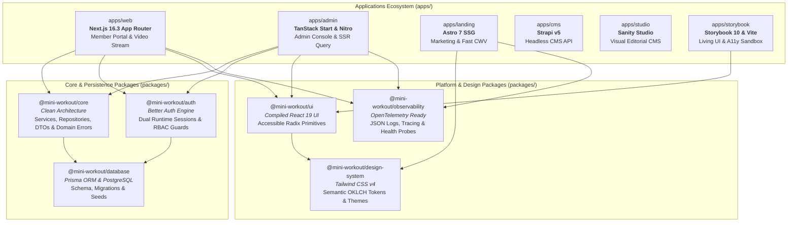
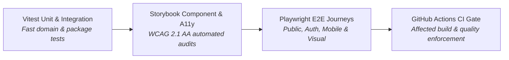
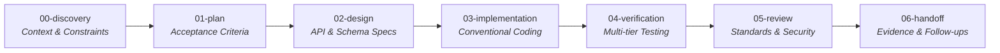

# Mini Workout — Full-Stack Production & Learning Guide

> **Audience:** Developers seeking to master modern full-stack TypeScript, Next.js 16.3, Node.js, and production-grade software architecture.  
> **Repository:** [Mini Workout Workspace](../README.md)

---

## Executive Summary

Mini Workout is designed as a **production-grade reference architecture and learning curriculum**. Rather than being a simplistic "to-do app" or a mock prototype, it demonstrates how real-world commercial software is built by orchestrating multiple specialized applications, domain-driven shared packages, and modern development tooling within a unified **Turborepo monorepo**.



---

## 1. Modern Frontend Mastery: Next.js 16.3 & React 19

The member-facing application ([`apps/web`](../apps/web)) is built on Next.js 16.3 and React 19. It serves as an active sandbox for the latest web paradigms.

### 1.1 Next.js 16.3 Experimental Engine

In [`apps/web/next.config.ts`](../apps/web/next.config.ts), next-generation platform features are enabled:

- **`cacheComponents: true`**: Activates Next.js experimental component-level caching.
- **`reactCompiler: true`**: Enables the React Compiler to automatically optimize memoization without manual `useMemo` or `useCallback` boilerplate.
- **`partialPrefetching: true`**: Reduces navigation latency by streaming pre-rendered static shells while fetching personalized dynamic slots.
- **`typedRoutes: true`**: Provides compile-time route validation, preventing broken navigation links.

### 1.2 Cache Components & Fine-Grained Invalidation

Unlike legacy caching mechanisms (`unstable_cache` or full-page static generation), Next.js 16 Cache Components provide granular, function-level caching:

```typescript
// Shared catalogue read with explicit cache lifetime and tagging
export async function getWorkoutCategories() {
  'use cache';
  cacheLife('hours');
  cacheTag(CACHE_TAGS.categories);

  return prisma.category.findMany({
    orderBy: { displayOrder: 'asc' },
  });
}
```

**Key Architectural Rules:**

1. **Cache Personalization Separation:** Caching is applied strictly to public, shared data (e.g., published workouts, categories). Personalized user data (likes, favorites, onboarding progress) resides outside the shared cache.
2. **Explicit Invalidation Boundary:** Invalidation is centralized in dedicated helpers (`apps/web/src/lib/cache/revalidate.ts`) using `updateTag()` during Server Actions so that the initiating request immediately observes fresh data.

### 1.3 React 19 Primitives & Optimistic UI

To deliver snappy feedback without waiting for server round-trips, user interactions utilize optimistic updates with graceful rollback:

- **Optimistic Likes & Favorites:** Implemented via TanStack React Query mutations (`useMutation`) with `onMutate` cache snapshots and `onError` rollback in [`apps/web/src/hooks/use-workout-engagement.ts`](../apps/web/src/hooks/use-workout-engagement.ts).
- **React 19 `<ViewTransition>`:** Used in [`apps/web/src/components/view-transitions/`](../apps/web/src/components/view-transitions) to morph thumbnails seamlessly between discovery cards and detail view heroes without third-party animation libraries.
- **Animated Suspense:** Dynamic streaming skeletons smoothly crossfade into loaded content via `<ViewTransition enter="slide-up" exit="slide-down">`.

### 1.4 Server Actions & Form Handling

Server Actions are treated with the rigor of external API endpoints:

- **Input Validation:** Every payload is validated against strict Zod schemas (`safeParse`) before database writes.
- **Unified Error Boundary:** Actions are wrapped with `withServerActionErrorBoundary()` to log unexpected exceptions, redact sensitive data, and return standardized error references.
- **State Machine Transitions:** The multi-step onboarding flow (`EXPERIENCE_LEVEL` → `INTERESTS` → `WEEKLY_SCHEDULE` → `FITNESS_GOALS`) enforces valid progression using server-side state machines.

---

## 2. Robust Backend & Database Engineering

The backend foundation is built around **Node.js 22 LTS**, **PostgreSQL**, and **Prisma ORM**, strictly following Clean Architecture.

### 2.1 Clean Domain Core (`packages/core`)

The business logic resides in [`packages/core`](../packages/core) and remains completely decoupled from frameworks (no dependency on Next.js, TanStack Start, React, or HTTP primitives):

```text
packages/core/src/
├── coaches/          # Coach domain queries and DTOs
├── onboarding/       # Onboarding state machine & business logic
├── users/            # User profile management
├── workouts/         # Workout discovery, filters & engagement logic
├── admin-pagination.ts # Cursor-based pagination algorithms
└── errors.ts         # Pure domain errors (NotFoundError, ValidationError, ConflictError)
```

**Domain Error Hierarchy:**

- `DomainError` (Base class)
  - `NotFoundError` (maps to HTTP 404)
  - `ValidationError` (maps to HTTP 400)
  - `UnauthorizedError` (maps to HTTP 401)
  - `ForbiddenError` (maps to HTTP 403)
  - `ConflictError` (maps to HTTP 409)

### 2.2 Persistence Layer (`packages/database`)

- **Prisma Schema:** Models entities including `User`, `Account`, `Session`, `Workout`, `Coach`, `Category`, `WorkoutLike`, and `WorkoutFavorite`.
- **Relational Integrity:** Explicit foreign keys, compound indexes (e.g., `@@unique([userId, workoutId])`), and indexed search fields.
- **Migration Pipeline:** Database schema migrations and deterministic seed scripts ensure identical local and staging environments.
- **Persistence Encapsulation:** Prisma types are kept internal to `packages/database`. Applications consume domain DTOs exposed by `packages/core`.

### 2.3 Authentication & Authorization (`packages/auth`)

- **Better Auth Integration:** Provides email/password authentication, database-backed sessions, and account management.
- **Dual Runtime Instances:** Because Next.js and TanStack Start utilize different cookie and request abstractions, `packages/auth` exports two dedicated instances sharing the same PostgreSQL schema.
- **Role-Based Access Control (RBAC):** Users are assigned roles (`MEMBER`, `ADMIN`). Protected routes verify session claims at the layout and API boundary.
- **Optimistic Routing Guard:** [`apps/web/src/proxy.ts`](../apps/web/src/proxy.ts) performs lightweight edge cookie checks to prevent layout flashes during redirects.

### 2.4 Mandatory Error Handling & Observability

Every service and route adheres to [`docs/ERROR_HANDLING_CONVENTION.md`](ERROR_HANDLING_CONVENTION.md):

- **Structured JSON Logging:** Categorized with `level`, `context`, `requestId`, and timestamp.
- **PII Redaction:** Passwords, tokens, and authorization headers are scrubbed before logging.
- **Health Probes:**
  - `/api/health/live`: Fast in-memory liveness probe (HTTP 200).
  - `/api/health/ready`: Deep dependency readiness probe verifying database connectivity via `pingDatabase()`.

---

## 3. The Multi-App Production Ecosystem

Mini Workout illustrates how distinct frameworks solve distinct problems within an enterprise architecture:

| Application          | Technology Stack                                                | Core Responsibility                                                                                 |
| :------------------- | :-------------------------------------------------------------- | :-------------------------------------------------------------------------------------------------- |
| **`apps/web`**       | Next.js 16.3 App Router, React 19, Tailwind CSS v4, Video.js 10 | Member portal, interactive onboarding, personalized feed, video streaming, likes & favorites.       |
| **`apps/admin`**     | TanStack Start, Nitro, TanStack Router, TanStack Query          | Back-office management console, cursor-based pagination, SSR hydration, system metrics.             |
| **`apps/landing`**   | Astro 7, Sanity Client, Tailwind CSS                            | High-performance public marketing website, static site generation (SSG), editorial preview.         |
| **`apps/cms`**       | Strapi v5 (Headless CMS)                                        | Self-hosted structured content management, relational content models, API token management.         |
| **`apps/studio`**    | Sanity Studio                                                   | Visual editorial experience for marketing campaigns and pricing page content.                       |
| **`apps/storybook`** | Storybook 10, Vite, `@storybook/addon-a11y`                     | Living component design system, interaction tests, accessibility contrast and screen-reader audits. |

---

## 4. Design System & Monorepo Best Practices

### 4.1 Turborepo Task Orchestration

The workspace leverages Turborepo 2.x with strict configuration in [`turbo.json`](../turbo.json):

- **Parallel Pipeline:** Tasks (`build`, `lint`, `check-types`, `test`) execute concurrently across the dependency tree.
- **Smart Remote Caching:** Cached build artifacts avoid redundant work in local development and GitHub Actions CI.
- **Dependency Catalogs:** Package versions are declared centrally in [`pnpm-workspace.yaml`](../pnpm-workspace.yaml) via pnpm catalogs, preventing version drift.

### 4.2 Strict Package Boundaries

Enforced via `eslint-plugin-boundaries` and `turbo boundaries`:

- Applications may import packages, but packages **must never** import from applications.
- Features within an application are strictly isolated: `features/workouts` cannot directly import from `features/onboarding`.
- Internal implementation details cannot be accessed via relative deep-paths; all access must use public package exports.

### 4.3 Design System Architecture

- **`packages/design-system`**: Owns semantic CSS design tokens using modern **OKLCH** color spaces (`--color-background`, `--color-surface`, `--color-primary`, `--color-ring`). Automatically handles light/dark theme variables.
- **`packages/ui`**: Standalone React component library compiled with `tsup`. Implements accessible Radix primitives, custom buttons, cards, dialogs, and navigation elements.
- **Accessibility Guarantee:** Storybook automated tests run with `@storybook/addon-a11y` with `test: 'error'`, failing on any WCAG 2.1 AA violation.

---

## 5. DevOps & Quality Engineering

Quality is guarded through automated verification at multiple layers:



1. **Unit & Integration Testing (Vitest):**
   - High-speed unit testing for domain logic in `packages/core` and utility libraries.
   - Database integration tests running against ephemeral or test PostgreSQL containers.
2. **End-to-End Testing (Playwright):**
   - Public user journey: Landing page browsing, workout search, filter state validation.
   - Authenticated user journey: Sign-in, onboarding wizard, video playback, engagement toggles.
   - Mobile viewport and visual regression testing.
3. **CI/CD Automation (GitHub Actions):**
   - Workflow in [`.github/workflows/ci.yml`](../.github/workflows/ci.yml).
   - Enforces linting, formatting, type checking, boundary checks, unit test coverage, and Playwright execution on every pull request.
4. **Git Hygiene:**
   - Conventional Commits enforced via `@commitlint`.
   - Pre-commit hooks managed by Husky and `lint-staged`.

---

## 6. Modern AI-Assisted Engineering Harness

Mini Workout incorporates a production-grade AI agent harness in [`.agents/`](../.agents):

### 6.1 Standard Delivery Lifecycle

Every non-trivial engineering task follows a disciplined 7-phase delivery loop:



1. **`00-discovery.md`**: Investigate constraints, existing code patterns, and dependencies.
2. **`01-plan.md`**: Define minimal, verifiable implementation steps and acceptance criteria.
3. **`02-design.md`**: Settle UI, API contracts, database schemas, and edge cases prior to writing code.
4. **`03-implementation.md`**: Execute changes strictly adhering to existing repository conventions.
5. **`04-verification.md`**: Run focused tests, linters, type checks, and browser verifications.
6. **`05-review.md`**: Audit against code standards, accessibility, performance, and security.
7. **`06-handoff.md`**: Produce a structured summary of changed files, verification results, and operational risks.

### 6.2 Specialized Skill Routing

The harness maintains vendored domain skills in `.agents/skills/` providing codified instructions for:

- `nextjs-app-architecture` & `nextjs-cache-architecture`: Best practices for RSC and caching.
- `better-auth`: Safe authentication patterns and session management.
- `prisma-client-api` & `prisma-database-setup`: Database query optimization and migrations.
- `tanstack-start` & `tanstack-query-best-practices`: TanStack architecture guidelines.
- `storybook`: Accessible UI component story creation.
- `observability-convention`: Enforcing uniform error reporting and logging.

---

## Summary Learning Checklist

Use this checklist to track your learning journey through the codebase:

- [ ] **React 19:** Inspect `<ViewTransition>` in `apps/web/src/components/view-transitions/`.
- [ ] **Optimistic UI:** Study `useMutation` with rollback in `apps/web/src/hooks/use-workout-engagement.ts`.
- [ ] **Next.js 16 Cache:** Review `cacheComponents: true` in `apps/web/next.config.ts` and tag invalidation in `apps/web/src/lib/cache/revalidate.ts`.
- [ ] **Server Actions:** Explore form validation and error wrapping in `apps/web/src/features/onboarding/actions.ts`.
- [ ] **Clean Architecture:** Examine framework-free business logic in `packages/core/src/workouts/`.
- [ ] **Dual Auth Instances:** Inspect the Better Auth configuration in `packages/auth/src/`.
- [ ] **TanStack Start:** Explore the admin routing and server functions in `apps/admin/`.
- [ ] **Design Tokens:** Check the OKLCH theme variables in `packages/design-system/src/globals.css`.
- [ ] **Monorepo Boundaries:** Review the boundary rules in `apps/web/eslint.config.js` and `turbo.json`.
- [ ] **AI Harness:** Follow the phase workflow defined in `.agents/phases/`.
